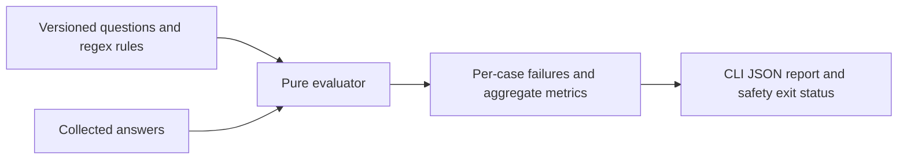

# Deterministic Answer Grader

An offline TypeScript grader for **already collected** LLM chat answers.
It applies versioned rules and produces a reproducible JSON report without
calling a model. The included example evaluates an agricultural assistant.

**Deno 2 · TypeScript · 13 tests · 19 example questions · MIT**

## Quick start

```bash
git clone https://github.com/TheLionGab/deterministic-answer-grader.git
cd deterministic-answer-grader
deno check src/avaliacao.ts cli/avaliar.ts
deno task test
deno task exemplo
```

The test suite imports `jsr:@std/assert@1`, pinned by `deno.lock`. The first
run needs network access to cache that dependency. After that:

```bash
deno test --cached-only
deno run --cached-only --allow-read cli/avaliar.ts data/perguntas.json examples/respostas-2026-10-15.json
```

Grading itself makes no network or model calls. The CLI only requests read access.

## Architecture



- [`src/avaliacao.ts`](src/avaliacao.ts): validation, normalization, grading, and metrics.
- [`src/regras.ts`](src/regras.ts): dosage patterns and a deliberately partial brand list.
- [`data/perguntas.json`](data/perguntas.json): required and forbidden patterns per case.
- [`cli/avaliar.ts`](cli/avaliar.ts): reads files and prints the report.

Answers use `{ "id": "case-id", "resposta": "collected answer" }` entries.
Each `deve` group requires at least one matching alternative; all groups must
pass. A matching `naoDeve` pattern fails the case. Text is normalized before matching.

## Reproducible example

The committed 15 October 2026 fixture contains 19 questions across six topics:
pests, weather, prices, costs, regulation, and out-of-scope requests.

- **18/19 answers pass**, score **0.947368…**.
- **Zero rule-detected dosage, product-concentration, or brand violations**.
- `praga-percevejo-sem-dado` fails: the answer requests crop stage and infestation
  level using an imperative, while the rule requires a question mark.

[`examples/resultado-2026-10-15.json`](examples/resultado-2026-10-15.json)
records the result. CI reproduces the 18/19 counts and zero violations.
The original documentation identifies this as a production collection; the
public evidence is the committed fixture, not an independently verified live run.
The false negative is preserved rather than changing the rubric to improve the score.

## Engineering Decisions & Test Strategy

| Incorrect implementation | Decision | Regression evidence in [`src/avaliacao_test.ts`](src/avaliacao_test.ts) |
| --- | --- | --- |
| Hide a dosage inside Markdown bold text. | Normalize Markdown before safety matching. | Bold dosage examples still fail. |
| Treat every agricultural quantity as a pesticide dosage. | Distinguish dosage contexts from rainfall, yield, fertilizer, and sack weight. | False-positive cases cover those quantities. |
| Match a required opening verdict anywhere in a multiline answer. | Anchor against the whole answer, without multiline mode. | A later bullet containing the expected word cannot repair a wrong opening. |
| Accept invalid or unreachable rubric patterns. | Validate version, IDs, themes, and normalized regex syntax. | Invalid, accented, uppercase, and duplicate-ID cases are rejected. |

A safety violation fails the answer and makes the CLI exit **1**. Quality
failures affect case scores but do **not** make the CLI exit nonzero.
Missing answers are counted separately; the score denominator includes only
evaluated answers. A downstream acceptance gate must also check completeness.

## Limitations

Regex checks form and selected safety patterns, not factual agronomic truth.
The brand list is incomplete. This is a 19-case regression fixture, not a
statistical benchmark, model ranking, RAG retrieval evaluation, or safety certification.
The production collector is not included.
